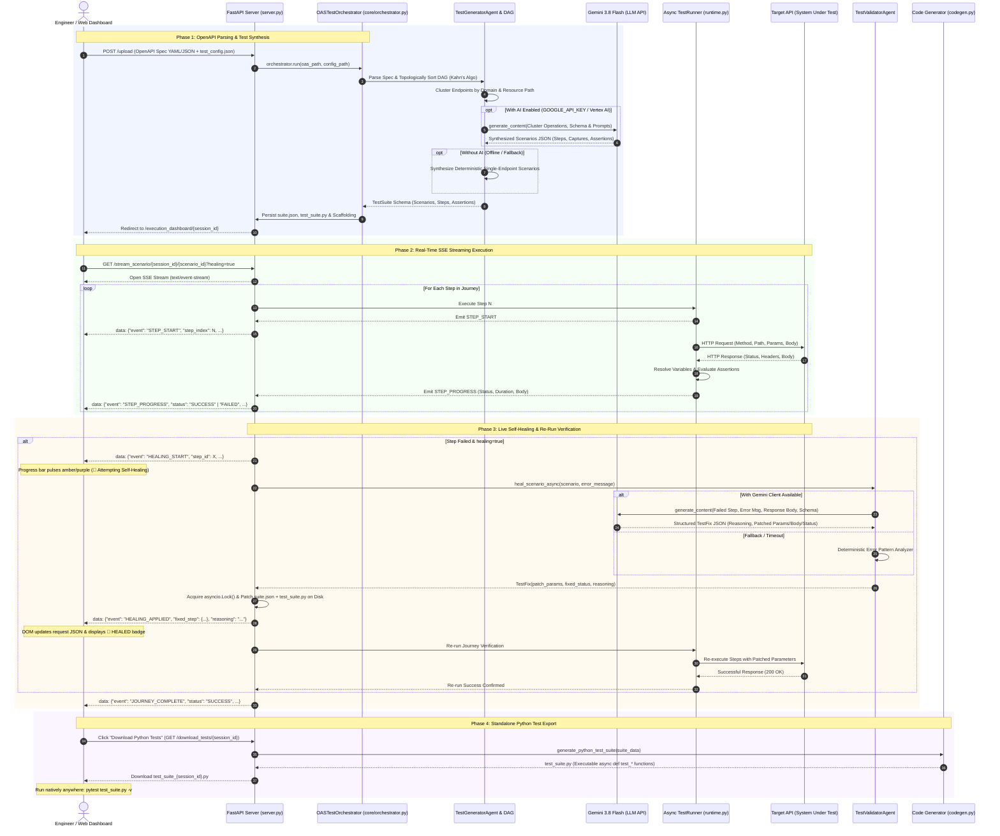
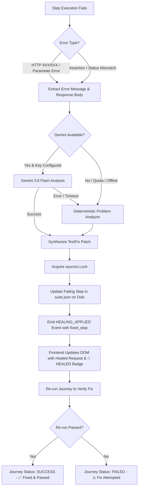
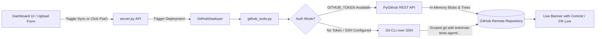

# System Architecture: OASVerify

This document provides a comprehensive architectural specification of the **OASVerify** platform. The system employs a **Hybrid Declarative Pipeline**, explicitly segregating deterministic execution constraints and versioned state from LLM-driven test synthesis, live self-healing, and code generation.

---

## 1. Architectural Philosophy

Automated API test generation typically suffers from two failure modes:
1. **Pure LLM Code Generation**: Highly brittle, hallucinates non-existent libraries or endpoints, fails to maintain state across long chains, and produces code with subtle syntax or import bugs.
2. **Pure Static Rule Generation**: Syntactically safe but lacks domain awareness, cannot intelligently chain entity IDs across disparate resource domains, and fails to handle real-world business constraints.

To solve this, our platform strictly divides the system into:

### ⚙️ Deterministic Infrastructure (The "Rails")
- **OpenAPI Parser ([`manager/core/oas_parser.py`](manager/core/oas_parser.py))**: Normalizes OpenAPI 3.0+ specifications and dereferences `$ref` structures via `OASParser`.
- **Topological DAG Sorting ([`manager/core/graph.py`](manager/core/graph.py))**: Parses the OpenAPI spec with `prance` and employs Kahn's algorithm to compute resource dependencies (e.g. `POST /v1/products` must execute before `GET /v1/products/{id}`).
- **Declarative Schema Enforcement ([`manager/core/schemas.py`](manager/core/schemas.py))**: Strongly-typed Pydantic models define the exact structure of a `TestSuite`, `TestScenario`, `TestStep`, `VariableCapture`, and `SemanticAssertion`.
- **Async Runtime Engine ([`manager/core/runtime.py`](manager/core/runtime.py))**: A high-performance `httpx`-based asynchronous execution loop that performs dynamic variable resolution (`{{var}}`, `$var`), extracts JSONPath captures, verifies type-coerced assertions (`are_values_equivalent`), and manages subpath redirects.
- **Pure-Python Code Generator & Scaffolder ([`manager/core/codegen.py`](manager/core/codegen.py), [`manager/core/suite_scaffolder.py`](manager/core/suite_scaffolder.py))**: Automatically translates the validated, healed declarative JSON suite into clean, standalone, idiomatic Python PyTest functions and visualization artifacts.
- **Quality Gate & GitHub Deployer ([`manager/core/quality_gate.py`](manager/core/quality_gate.py), [`manager/core/github_deployer.py`](manager/core/github_deployer.py))**: Performs syntax/discovery checks and publishes validated suites to timestamped GitHub folders.

### 🤖 AI Synthesized Logic & Live Validation (The "Brain")
Operating within the rigid bounds of the deterministic schema, `manager/agents/` contains **only** the two LLM-powered agents:
- **Scenario & Workflow Generation ([`TestGeneratorAgent`](manager/agents/test_generator_agent.py))**: Gemini 3.8 Flash clusters operations by domain and synthesizes realistic multi-step user journeys (happy path, boundary validation, and negative testing), strictly avoiding speculative dynamic assertions. Includes a deterministic fallback when AI credentials are absent.
- **Data Mocking & JSONPath Captures**: Generates valid payload structures and downstream capture expressions (e.g. `$.id`, `$.features[0].properties.id`).
- **Autonomous Live Validation & Self-Healing ([`TestValidatorAgent`](manager/agents/test_validator_agent.py))**: Diagnoses live API rejections (4XX, schema mismatch, regex violations, enumeration errors, brittle semantic assertions), patches the test definitions on disk without blindly weakening happy-path assertions, and verifies fixes with real-time re-runs.

---

## 2. End-to-End System Sequence Diagram



---

## 3. Core Subsystems

### A. The Deterministic Core Package (`manager/core/`)

1. **`schemas.py` (Typed Data Models)**
   - Strict Pydantic models defining the declarative contract:
     - `TestSuite`: Top-level container holding `suite_id`, `target_base_url`, and `scenarios`.
     - `TestScenario`: A logical journey with `setup_steps`, `test_steps`, and `teardown_steps`.
     - `TestStep`: Atomic HTTP operation (`method`, `path_template`, `path_params`, `query_params`, `headers`, `request_body`, `expected_status`, `captures`, `semantic_assertions`).
     - `VariableCapture`: Extraction rules mapping response JSONPaths to context variables.
     - `SemanticAssertion`: Validation constraints (`EQUALS`, `NOT_EQUALS`, `CONTAINS`, `NOT_NULL`, `GREATER_THAN`, `LESS_THAN`, `MATCHES_REGEX`).

2. **`graph.py` (Topological Dependency Sorting)**
   - Constructs a directed graph of endpoints based on path hierarchy and HTTP methods:
     - `POST` (Creation) $\rightarrow$ `GET` (Retrieval) $\rightarrow$ `PUT`/`PATCH` (Mutation) $\rightarrow$ `DELETE` (Cleanup).
   - Uses Kahn's topological sort algorithm to ensure workflows adhere to natural REST lifecycle order.

3. **`runtime.py` (Execution Engine & Assertion Engine)**
   - **`VariableResolver`**:
     - Resolves both double-braced `{{var}}`, single-braced `{var}`, and `$var` placeholders against runtime context.
     - `extract_jsonpath`: Pure-Python zero-dependency JSONPath parser supporting dot and bracket notations (`$.['@graph']`), automatic unwrap of standard OpenAPI collections (`features`, `@graph`, `items`, `data`, `results`, `entry`), and terminal ID extraction from full resource URIs.
   - **`AssertionEngine`**:
     - `are_values_equivalent`: Case-insensitive and type-coerced equality check (handles JSON boolean `False` vs string `"false"`, integer `10` vs `"10"`, etc.).
     - Generic case-insensitive substring verification for `CONTAINS`, numeric comparisons (`GREATER_THAN`, `LESS_THAN`), and regex matching (`MATCHES_REGEX`).
   - **`TestRunner`**:
     - Asynchronous HTTPX client equipped with `on_step_progress` callbacks.
     - Includes a redirect event hook (`rewrite_redirect`) ensuring subpath reverse proxies (e.g. `/weather_oas`) are preserved when APIs issue relative-to-root `Location: /...` redirects.

4. **`codegen.py` (Python PyTest Code Generator)**
   - Translates validated JSON test suites into standalone, runnable Python files (`test_suite.py`).
   - Every scenario becomes an independent, named `@pytest.mark.asyncio async def test_<scenario_name>()` function.
   - Self-contained with embedded helper functions; requires only `httpx` and `pytest`.

5. **Deterministic Pipeline Modules (`oas_parser.py`, `suite_scaffolder.py`, `quality_gate.py`, `github_deployer.py`, `orchestrator.py`)**
   - **`OASParser` (`oas_parser.py`)**: Resolves `$ref` references and normalizes OpenAPI 3.0+ specs into typed metadata.
   - **`TestSuiteScaffolder` (`suite_scaffolder.py`)**: Scaffolds session directories and writes `suite.json`, `test_suite.py`, `test_api_runner.py`, and interactive `visualize.html`.
   - **`TestQualityGate` (`quality_gate.py`)**: Verifies syntax compilation and PyTest test discovery before completion.
   - **`GitHubDeployer` (`github_deployer.py`)**: Deploys generated test suites into timestamped repository folders via GitHub REST API or Git SSH.
   - **`OASTestOrchestrator` (`orchestrator.py`)**: Coordinates the end-to-end deterministic steps and LLM agents.

---

### B. LLM Agents (`manager/agents/`)

| Agent | File | Responsibility | Implementation |
|---|---|---|---|
| **`TestGeneratorAgent`** | `manager/agents/test_generator_agent.py` | Analyzes endpoint operations, clusters them by resource domain, and synthesizes structured test scenarios while avoiding brittle dynamic assertions. | Gemini 3.8 Flash with structured outputs + deterministic fallback. |
| **`TestValidatorAgent`** | `manager/agents/test_validator_agent.py` | Validates live runtime failures and synthesizes targeted `TestFix` patches to parameters, bodies, assertions, or status expectations. | Dual-mode: Gemini 3.8 Flash + deterministic RFC 7807 problem parser. |

---

### C. Web Server & Execution Dashboard (`server.py`)

- **Interactive Dashboard**:
  - Serves dynamic execution dashboards at `/execution_dashboard/{session_id}`.
  - Features scenario-scoped step DOM elements (`id="step_card_{sc_id}_{st_id}"`), preventing ID collisions across journeys.
- **Server-Sent Events (SSE) Streaming**:
  - `GET /stream_scenario/{session_id}/{scenario_id}`: Streams live step-by-step progress and self-healing transitions for single journeys.
  - `GET /stream_suite/{session_id}`: Concurrent parallel execution across journeys bounded by `asyncio.Semaphore(4)`, reducing suite runtimes by ~4x.
  - Disk write safety via `asyncio.Lock()` to prevent concurrent self-healing race conditions.
- **Export & Download Endpoints**:
  - `GET /download_tests/{session_id}`: Generates and downloads the standalone Python PyTest script (`test_suite_{session_id}.py`).
  - `GET /download_suite/{session_id}`: Downloads the raw declarative `suite.json`.

---

## 4. Autonomous Self-Healing Pipeline

When a test step fails during execution and `healing=true`:



---

## 5. Execution Sandboxes & Workspaces

All session-specific data lives in isolated directories under `session_workspaces/<session_id>/`:
```
session_workspaces/<session_id>/
├── tests/
│   ├── suite.json          # Declarative test definitions (auto-updated by self-healing)
│   ├── test_suite.py       # Standalone executable PyTest suite
│   ├── test_api_runner.py  # Parameterized runner wrapper
│   └── results.xml         # JUnit XML execution report (generated by run_suite.py)
├── github_sync.json        # Synchronization metadata, commit SHA, and folder URL
└── visualize.html          # Interactive DAG flowchart visualization
```

---

## 6. GitHub Integration & Deployment Architecture



The system organizes test suites into isolated, timestamped partitions:
```
tests/oas-tests-agent/{YYYY-MM-DD_HH-MM-SS}/
├── README.md              # Markdown documentation & execution guide
├── test_suite.py          # Standalone PyTest executable file
├── suite.json             # Structured scenario definitions
└── test_api_runner.py     # Parameterized runner wrapper
```

### Architectural Guarantees:
1. **Isolated Branch Publishing**: Never pushes directly to `main`. Every sync publishes to a dedicated branch named `oas-tests-agent/{timestamp}`.
2. **Zero Overwrite Collisions**: Every generation creates a dedicated, chronological directory under `tests/oas-tests-agent/{timestamp}/` ensuring complete historical test traceability.
3. **Dual Auth Resilience & Remote Safety**: Supports cloud environments (via `GITHUB_TOKEN` API calls) and local developer setups (via existing Git SSH keys). Local Git CLI push strictly verifies that the configured target repo matches the local git remote before staging.
4. **Working Tree Isolation**: In local Git CLI mode, a dedicated checkout (`git checkout -B oas-tests-agent/{timestamp}`) isolates changes, and returns to the previous working branch upon completion so `main` is completely untouched.

